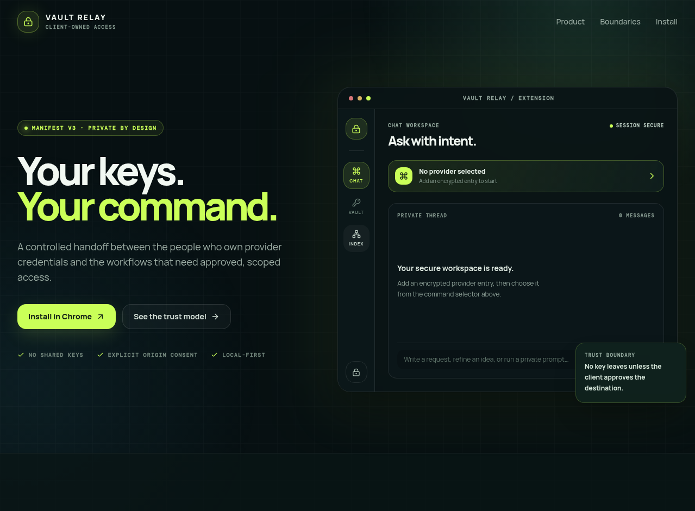

# Client API Vault Relay Chrome Extension


> **Client-owned keys. Approved provider access.**
>
> Client API Vault Relay is a Manifest V3 Chrome extension for keeping API provider credentials inside an encrypted local vault. A provider request is allowed only after the person using the extension selects that provider and approves its precise origin at runtime.



## What it solves

Teams often need to discover provider endpoints, save connection details, and run approved requests without spreading raw API keys through a shared control plane. This extension creates a clearer trust boundary: credentials remain encrypted in the user’s Chrome profile, while provider-specific access is selected and approved in context.

| Capability | What it does | Boundary |
| --- | --- | --- |
| **Encrypted local vault** | Stores provider entries in a password-protected envelope in `chrome.storage.local`. | The vault password is never persisted. |
| **Exact-origin approval** | Requests Chrome permission only for the provider origin the user chooses at the point of use. | No blanket runtime access is assumed. |
| **Provider catalog** | Displays sourced, free-access discovery records with base URLs, route templates, setup links, and provider labels. | Discovery data is not a credential or authorization. |
| **Direct vault entry** | Prefills supported provider details from a compatible catalog record. | The user still controls the credentials and approval. |
| **Session lock** | Clears in-memory access when the vault is locked. | Secrets are not left active indefinitely. |

## Security model

The extension is deliberately designed around a client-controlled credential boundary.

> API keys are encrypted in the extension’s local storage using a user-created password. The password is not stored. Keys and prompts are sent only to the provider selected by the user after that provider’s exact origin has been approved.

| Included | Intentionally excluded |
| --- | --- |
| Manifest V3 popup and local background worker | Remote script loading |
| Local encrypted credential envelope | Advertising analytics |
| User-approved provider-origin permissions | Developer-operated credential relay |
| Source-attributed endpoint discovery | Silent provider-origin access |

## Install in Chrome

### Option A — Chrome Web Store archive

The verified Chrome upload archive is included at:

```text
client-api-vault-relay-chrome-extension-1.0.1.zip
```

Use this ZIP for the Chrome Web Store Developer Dashboard. It contains the manifest, popup runtime, background worker, extension-local logic, and all required icon images.

### Option B — load the source locally

1. Download `client-api-vault-relay-chrome-extension-source-1.0.1.zip` from this repository and extract it.
2. Open `chrome://extensions`.
3. Enable **Developer mode**.
4. Select **Load unpacked**.
5. Choose the extracted `extension/` directory.
6. Open the extension popup and create a local vault.

## First-use workflow

1. Create and unlock an encrypted vault using a password you control.
2. Open **APIs** to inspect a provider record, setup link, base URL, and route template.
3. Add a provider manually, or prefill a supported provider record.
4. Select the provider when you are ready to use it.
5. Approve the precise provider origin when Chrome asks.
6. Lock the vault when the current session is complete.

The provider catalog is a discovery aid. A listed provider may require an account, a key, a particular region, or a manual adapter review. The catalog is never a guarantee of availability or authorization.

## Development and verification

This repository keeps the extension package and its validation scripts together. Install dependencies with `pnpm install`, then use the following commands from the repository root:

```bash
pnpm run extension:validate
pnpm run extension:package
```

| Command | Purpose |
| --- | --- |
| `pnpm run extension:validate` | Checks the package contract, then runs the extension test suite. |
| `pnpm run extension:package` | Validates the extension and creates a fresh Chrome Web Store ZIP. |
| `pnpm test` | Runs the broader repository test suite. |
| `pnpm check` | Runs the TypeScript check. |

The current package workflow verifies Manifest V3 metadata, CSP and local-code boundaries, required icon paths, catalog fields, permission behavior, encrypted-vault behavior, and core popup controls. The complete repository source is also available as `client-api-vault-relay-chrome-extension-source-1.0.1.zip` in this repository root.

## Source archive map

```text
extension/                         Manifest V3 source loaded by Chrome
  manifest.json                    Extension identity, permissions, CSP, and icon mappings
  popup.html / popup.js / styles.css
                                    Popup experience and provider catalog surface
  vault.js                          Local encrypted vault handling
  permissions.js                    Exact provider-origin approval flow
  catalog.js                        Source-attributed provider discovery data
  background.js                     Extension background worker
  icons/                            Required 16 / 32 / 48 / 128px assets
  *.test.js                         Extension unit and popup-flow tests
package_chrome_extension.mjs        Chrome ZIP packaging entry point
validate_extension_package.mjs      Deterministic package validation entry point
release/                            Verified upload archive
docs/images/                        Product-preview image used in this README
```

## Chrome Web Store checklist

- [ ] Upload `client-api-vault-relay-chrome-extension-1.0.1.zip`, not the source directory.
- [ ] Complete Store Listing, Privacy, and Distribution fields in the Developer Dashboard.
- [ ] Describe the vault as local encrypted storage and disclose the provider-origin permission flow.
- [ ] Do not claim provider records are permanently free, universally available, or automatically approved.
- [ ] Add reviewer instructions that explain the local vault setup and exact-origin permission prompt.

## License

This repository is released under the [MIT License](LICENSE).

---

Built to keep **provider credentials client-controlled** and **origin access explicit**.
